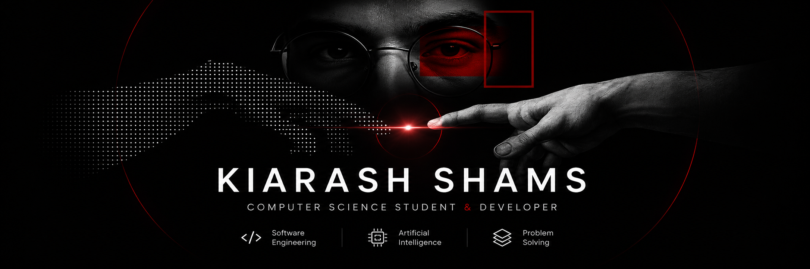

  

 
<h1 align="center">Kiarash Shams</h1>

<h3 align="center">Computer Science Student & Developer</h3>

   Software Engineering · Artificial Intelligence · Problem Solving 

    

### About Me

I'm a Computer Science student at the University of Messina, interested in IoT, intelligent systems, and building practical applications.

🎓 Computer Science student at the University of Messina, Italy.

💻 Interested in IoT devices and software engineering.

🤖 Exploring Artificial Intelligence and Machine Learning.

🧠 Interested in knowledge representation and intelligent reasoning.

🚀 Continuously learning and building new things.

### 💻 Programming Languages

  

| Technology | Proficiency |
|:---|:---|
| Python | Advanced |
| MySQL | Advanced |
| C | Intermediate – Upper |
| PHP | Intermediate |
| JavaScript | Beginner |
| Java | Currently Learning |

### ⚙️ Backend & Databases

  

| Technology | Proficiency |
|:---|:---|
| MongoDB | Advanced |
| Node.js | Intermediate |

### 🌱 Currently Learning

  

- Object-Oriented Programming (Java)
- Arduino IDE
## 🚀 Featured Projects

<table>
<tr>
<td width="33%" valign="top">

<h3>🧠 Symbolic Knowledge Demo</h3>

Exploring symbolic knowledge representation,
logical reasoning and intelligent systems.

<strong>Python</strong>

  

<a href="https://github.com/kiarashshams/Symbolic-knowledge-Demo">
View Project →
</a>

</td>

<td width="33%" valign="top">

<h3>🤖 Knowledge Distillation</h3>

Exploring knowledge distillation techniques
and intelligent systems.

  

<a href="https://github.com/kiarashshams/KD-Project">
View Project →
</a>

</td>

<td width="33%" valign="top">

<h3>🍕 Pizza Shop</h3>

A web development project focused on
building a pizza shop website.

<strong>PHP</strong>

  

<a href="https://github.com/kiarashshams/PizzashopConclusion">
View Project →
</a>

</td>
</tr>
</table>

## 📊 GitHub Analytics

  
  

  

---
## 📬 Connect With Me

  

  

  <i>Learning continuously. Building thoughtfully. Improving every day.</i>

